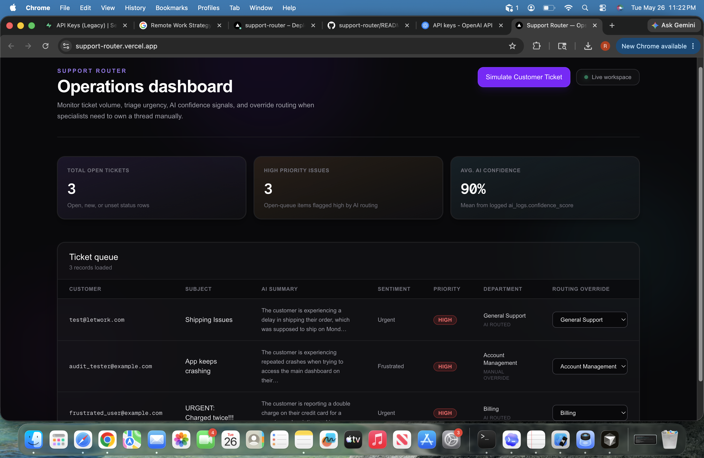
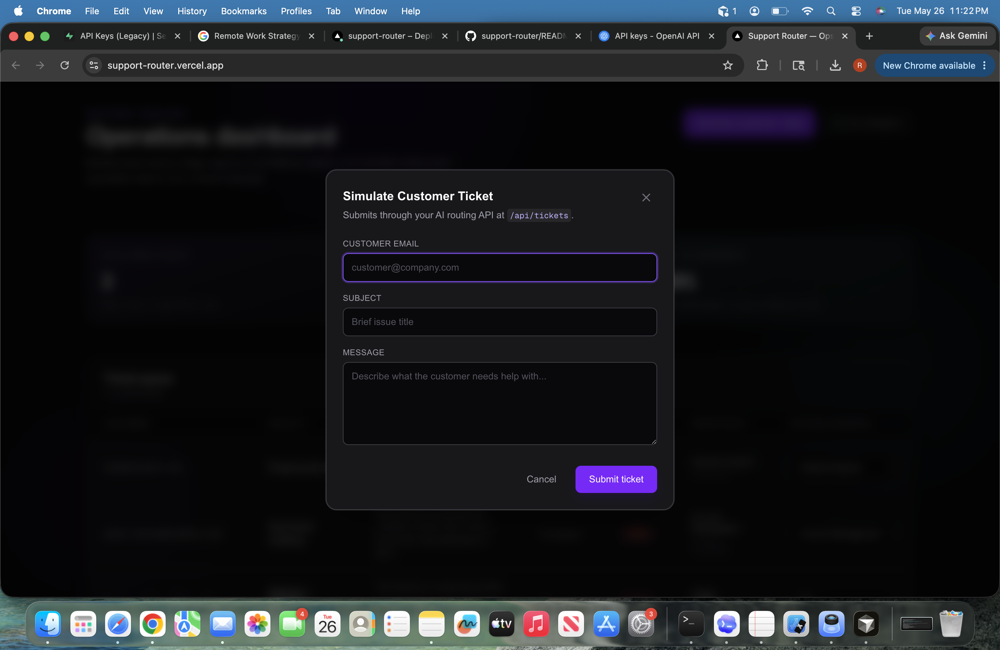
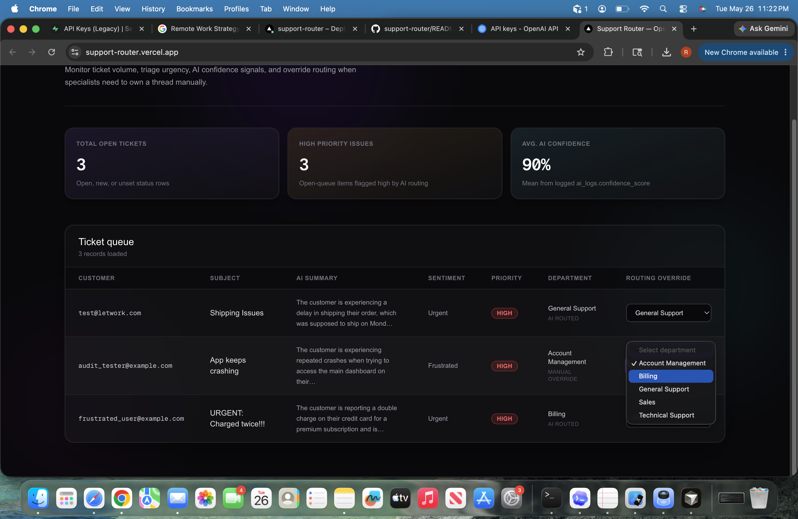

# Support Router

**Support Router** automatically classifies incoming customer support messages—assigning priority, sentiment, summary, and department—so teams spend less time on manual triage. Operators review results on a dashboard and can override routing when needed.

**Live demo:** [support-router.vercel.app](https://support-router.vercel.app/)

---

## Why this exists

Support teams often read every ticket by hand to decide urgency and who should handle it. That work is slow, inconsistent, and does not scale with volume. Support Router handles the first pass: AI reads each message, routes it to the right department, and logs the decision. Humans stay in control with one-click overrides.

---

## Tech stack

| Layer | Technology |
|-------|------------|
| Frontend & API | Next.js 16 (App Router), React 19, TypeScript |
| Styling | Tailwind CSS v4 |
| Database | Supabase (PostgreSQL) |
| AI | OpenAI Chat Completions (`gpt-4o-mini`) |
| Deployment | Vercel |

---

## What it does

1. **Ingest** — Customer tickets arrive via public `POST /api/tickets` (email, subject, message). That endpoint is rate limited and returns only the ticket that was just created.
2. **Classify** — OpenAI returns structured JSON: sentiment, priority, summary, suggested department, and confidence score.
3. **Route** — The ticket is saved to Postgres with the matched department.
4. **Audit** — Every AI run is logged in `ai_logs` for review and debugging.
5. **Override** — Signed-in operators can reassign departments from the dashboard; manual changes are tracked separately from AI routing.

---

## Screenshots

### Dashboard — metrics and ticket queue



Open ticket counts, high-priority load, and average AI confidence appear above a live ticket table backed by Supabase.

### Simulate a customer ticket



Submit a test ticket through the same API path used in production—no internal tools required.

### Department override



Operators can change the assigned department; the system records whether routing was AI-driven or manual.

---

## Local setup

**Prerequisites:** Node.js 18+, a Supabase project, and an OpenAI API key.

```bash
git clone https://github.com/RichTravels/support-router.git
cd support-router
npm install
cp .env.example .env.local
```

Edit `.env.local` with your credentials:

| Variable | Required | Notes |
|----------|----------|-------|
| `NEXT_PUBLIC_SUPABASE_URL` | Yes | From Supabase project settings |
| `NEXT_PUBLIC_SUPABASE_PUBLISHABLE_KEY` | Yes | Supabase publishable (anon) key. Safe to expose to the browser. |
| `SUPABASE_SERVICE_ROLE_KEY` | Yes | Server-only. Bypasses row level security. Never use a `NEXT_PUBLIC_` name. |
| `OPERATOR_EMAILS` | Yes | Comma-separated emails allowed to sign in and work tickets. |
| `OPENAI_API_KEY` | Yes | Server-only; never expose as `NEXT_PUBLIC_*` |
| `TICKET_INTAKE_RATE_LIMIT` | No | Public intake cap per IP. Default `10`. |
| `TICKET_INTAKE_RATE_WINDOW_SECONDS` | No | Window for that cap. Default `60`. |

### Operator access

The dashboard, department changes, and `/api/test-db` require a signed-in operator. Sign-in uses Supabase Auth email and password (already provided by `@supabase/ssr`). There is no public signup in the app.

1. In the Supabase dashboard, open **Authentication → Providers** and enable Email.
2. Under **Authentication → Sign In / Providers** (or **Settings**), turn off public signups so strangers cannot create accounts.
3. Create each operator under **Authentication → Users** with a password, and mark the email confirmed.
4. Put those same emails in `OPERATOR_EMAILS`. A signed-in user who is not on the list is signed back out.

`POST /api/tickets` stays public so a customer (or the Simulate Customer Ticket button) can file one new ticket. It does not list or update existing tickets. Repeated calls from the same IP are rate limited (8 sign-in attempts per 15 minutes is a separate limit on the login form).

Start the dev server:

```bash
npm run dev
```

Open [http://localhost:3000](http://localhost:3000). You will be asked to sign in before any ticket is shown. After signing in, use the "Simulate Customer Ticket" button or send a POST to `/api/tickets`:

```json
{
  "customer_email": "customer@example.com",
  "subject": "Billing question",
  "message": "I was charged twice this month."
}
```

**Other commands:**

```bash
npm run lint
npm run build
```

---

## Database

The app expects three Supabase/Postgres tables: `departments`, `tickets`, and `ai_logs`. See `.env.example` for the full environment variable list.

Those tables must not be readable through the public Data API. Apply `supabase/migrations/20261022032743_lock_down_ticket_tables.sql` in the Supabase SQL editor (or `supabase db push` against the linked project). The script turns on row level security, removes existing policies on those tables, and revokes `anon` and `authenticated` access. The server still uses the service role key after it has checked the operator session. Public ticket intake is the one path that writes without a session, and it only inserts the new row.

---

## License

MIT — see [LICENSE](LICENSE).
